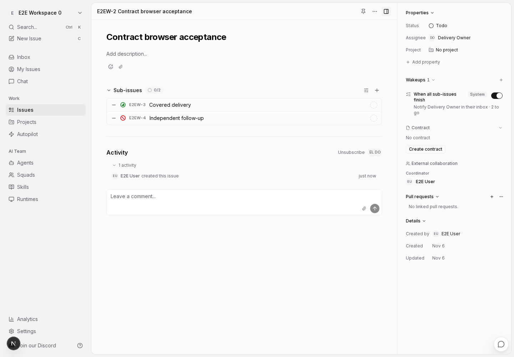
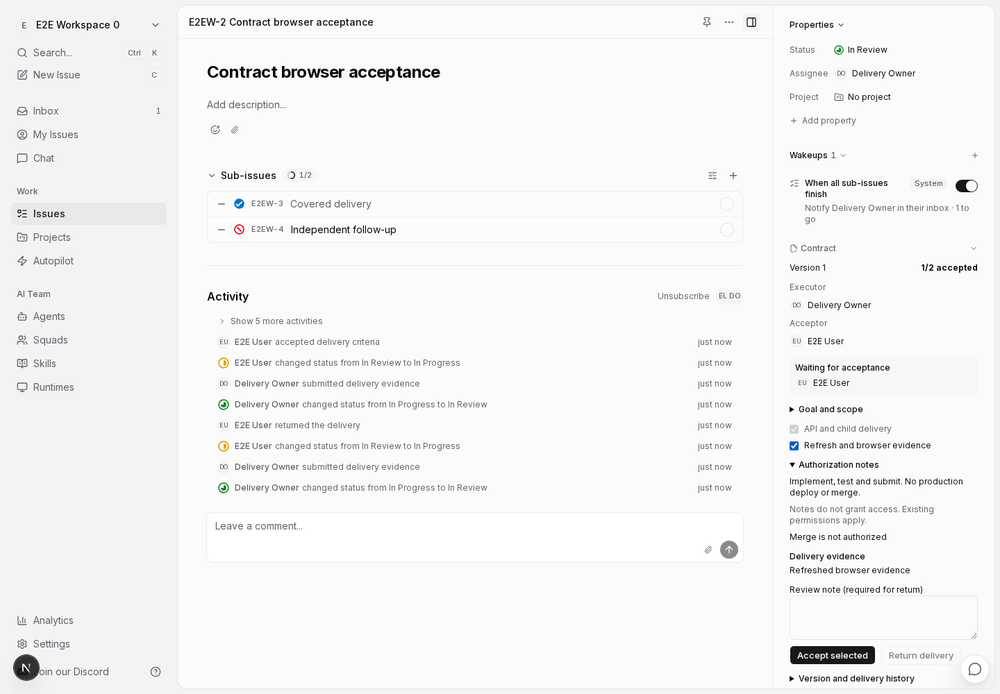
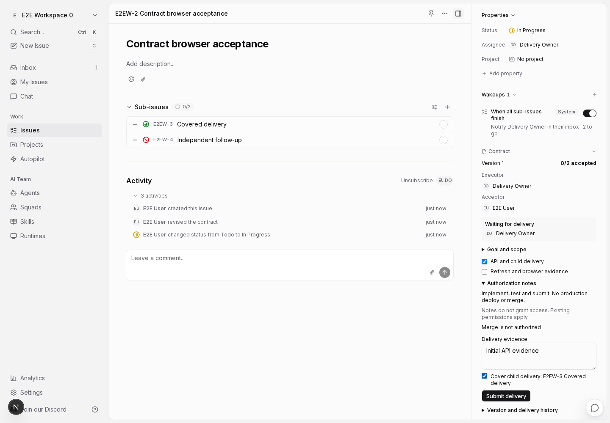
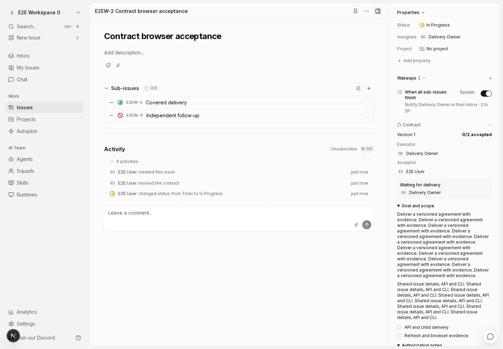
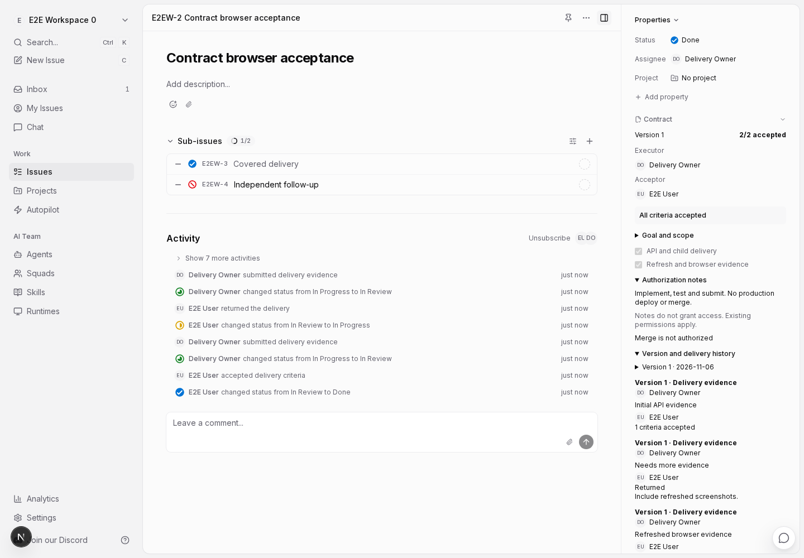
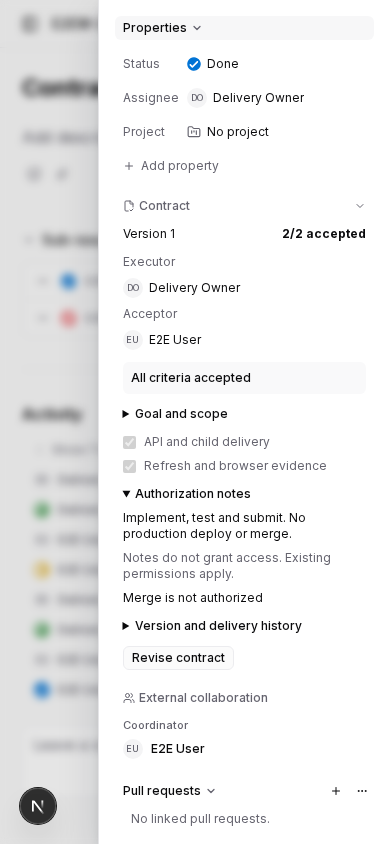
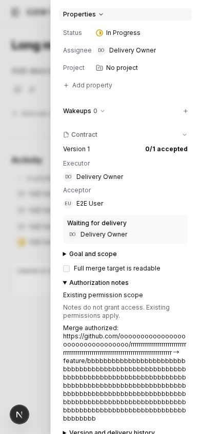

# Issue contract verification

The implementation extends `feat/task-session-delivery@1a017f993`.
Production revision `20c6a357e` contains the API, CLI, shared UI and independent
review fixes; the evidence commit adds this report, screenshots and the isolated
migration round-trip test. WORK-178 and PR12 record subsequent review and CI gates.
UI revision `20e424ec3` additionally separates conflict recovery from unknown-result
retry and wraps long structured permission targets.

## Behavior and evidence

| Boundary | Executed validation | Result |
| --- | --- | --- |
| Delivery lifecycle | Contract handler integration tests: submit, partial accept, return, resubmit, final accept, persisted history | Passed |
| Identity and authorization | Real Auth middleware with fixture mea/mat credentials; original creator, originator and creation scope; noncreator/executor/terminal source denied; notes never change native merge grants | Passed |
| Version and concurrency | Old-version decisions rejected, request UUID replay, conflicting UUID content, concurrent expected sequence | Passed |
| Native issue state | Review/done/same-status revisions advance owner revision once; cross-column rank changes; done permission revocation remains available | Passed with race |
| Restored context | Real claim detects a note-only revision; direct snapshot + production hint requires reading changed criteria; v2 snapshots preserve legacy no-contract behavior | Passed with race |
| Wakeups | Member/mea/mat actor filters, correct source task, note-only events, source's own wakeup suppressed | Passed with race |
| Child closure | Explicit direct covered child closes atomically; unrelated/blocked child unchanged; invalid child rolls back the whole acceptance | Passed |
| Existing PR automation | Real fixture GitHub merge cannot accept a contract; an uncontracted issue still closes | Passed |
| Native update/claim/status paths | Scoped handler race suite plus execenv, migrate and server packages | Passed |
| Migrations | 650–653 up/down/up in a scratch schema, concurrent unique index validity, unaccepted Done refusal and completed permission revocation | Passed |
| API response compatibility | Zod boundary defaults capabilities to denied, isolates malformed additive issue summaries, rejects malformed contract state; realtime cache tests | Passed |
| Type checking | Root `pnpm typecheck`, Web/Desktop/shared packages, excluding independent native mobile | Passed |
| Lint | Root `pnpm lint` | Passed with existing warnings |
| Frontend tests | Node22 full suite had one complete pass; a later full repeat hit an unchanged workflow-editor test timeout; its isolated rerun plus locale parity passed 216 tests | Full repeat limitation retained |
| Browser and CLI | Three Playwright scenarios described below | Passed |
| Conflict recovery | Submit/review discard old selections and restart at the current version; unknown results retry the original UUID | Three component regressions passed |
| Long merge target | Actual 390px browser, long repository and legal 220-character branch, local sidebar overflow check | Passed |

Go validation used Go 1.26.9, the checkout's managed database, and the agent CLI
guard for the expanded handler suite. Race tests used the system GCC. The local
API was stopped during DB fixture validation. A broad first Go invocation was
not green: the managed-directory marker affects existing CLI tests, a stale
fixture email collided, and parallel package fault injection affected a service
test. Those failures are not represented as passes or hidden by retries.

The browser used Playwright 1.58.2 with the existing Chromium 140 headless shell
through an ignored local config. The default browser download stalled and was
stopped by its exact task-owned PID. The application used this checkout's
managed API plus a foreground `make env-exec` Web process; the detached Web
ownership preflight could not identify its listener. No shared service was
restarted and no real agent provider or paid canary ran.

## Browser scenarios

`e2e/issue-contract.spec.ts` uses separate fixture member sessions for executor
and acceptor. It creates an agreement through the right sidebar, submits evidence,
partially accepts and closes a covered child, returns another delivery, resubmits,
accepts the final criterion, refreshes and inspects history. It checks that the
independent blocked child remains blocked. It then opens the responsive Properties
sheet, checks horizontal overflow and Escape dismissal, and revises the completed
agreement while the executor's second window observes the new native status
without refresh.

`e2e/issue-contract-cli.spec.ts` uses a freshly built Multica CLI and a fixture
task-scoped token. It reads, submits, replays the same request idempotently, and
accepts through the same API. The fixture run is never executed by an agent daemon.

`e2e/issue-sidebar-containment.spec.ts` verifies that overflowing sidebar content
does not stretch the surrounding panels.

The long-target scenario first exceeded the cold navigation budget before the
page header appeared; after adding an explicit page-readiness check, the same
browser scenario passed in 8.2s. The main three browser scenarios also passed
against the UI recovery revision. Permission values remain visible and wrap
inside the sidebar rather than being hidden or truncated.

## Screenshots

Before explicit contract creation:

Partial acceptance, current executor and waiting acceptor:

Executor submission:

Long goal and scope remain inside the sidebar scroller:

Accepted history after refresh:

390px responsive Properties sheet:

Long structured merge target at 390px:

## Delivery limits

Contracts are opt-in; old descriptions are not migrated into fabricated contracts.
A new dispatcher does not inherit editing rights merely by becoming coordinator.
Named project workflows must include the native contract statuses. Authorization
notes are descriptive; the existing structured policy remains authoritative.

The Multica PR-link endpoint returned 404. A workspace installation read confirmed
`configured=false`, `installations=[]`, and `repository_browse_configured=false`.
The PR exists in GitHub, but its formal Multica card link remains a delivery gap;
this work does not expand GitHub App access.
