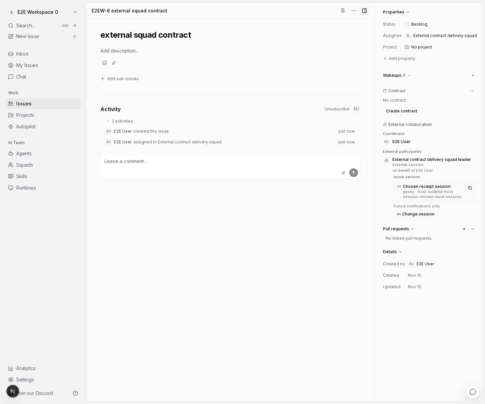
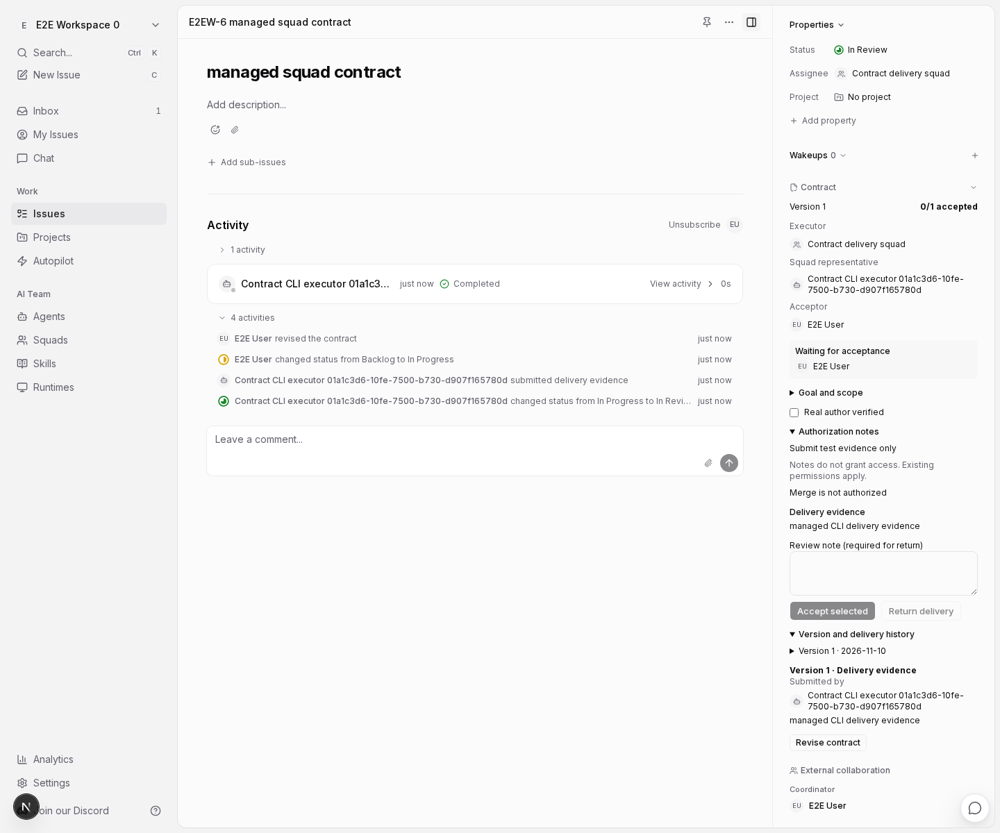
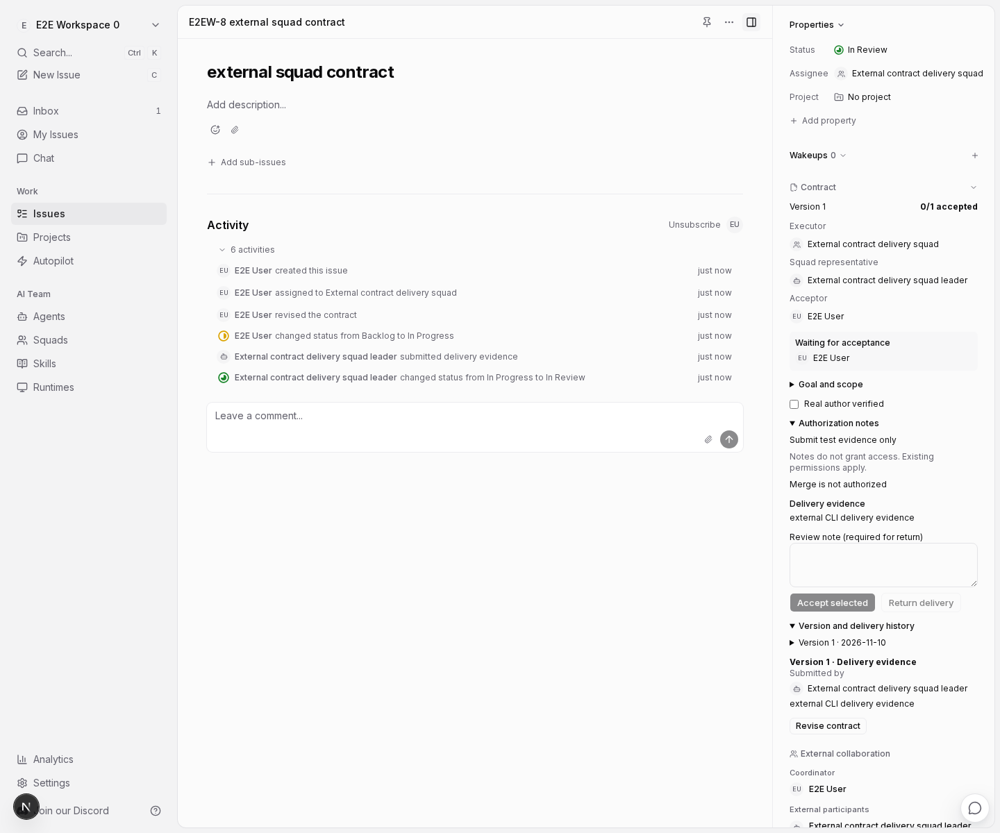
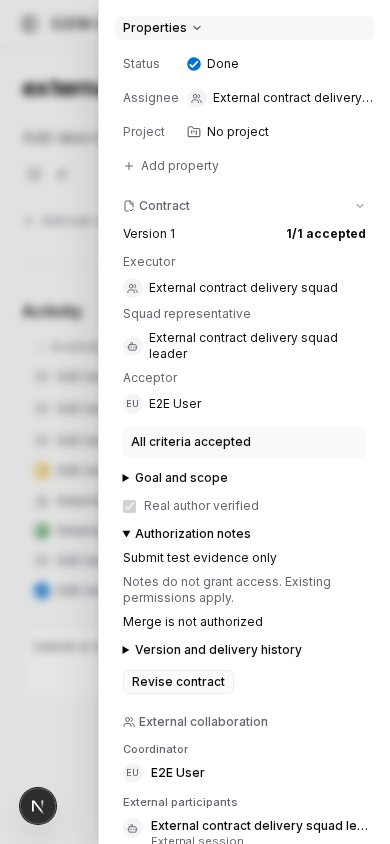

# Squad contract verification

The production change extends `feat/task-session-delivery@c0ca6c786`.
Permission slice `ed75a7066` passed independent review in WORK-258 criterion 0;
`4c9237c42` adds shared UI/schema, claim context and documentation. The complete
browser/CLI run used test revision `818b12dc2`. No real agent provider or paid
agent CLI was executed. PR17 targets `feat/task-session-delivery`; merge and
deployment remain outside this delivery's authorization.

## Executed checks

| Boundary | Evidence | Result |
| --- | --- | --- |
| Real identities | Auth middleware with fixture mat/mea tokens; squad stays executor, real leader is delivery author | Passed |
| Lifecycle | Submit, partial accept, return, resubmit, final accept; member/agent regression suite | Passed |
| Authority | Worker refusal, current/historical leader cannot maintain its own agreement, self-acceptance refused | Passed |
| Role changes | Old pending version becomes stale, replacement requires requester revision, history unchanged | Passed |
| Concurrent changes | Leader change, squad/leader archival, managed revision vs teardown lock order | Passed |
| Independent slice review | Reviewer ran 19 TestContract tests and retry/idempotency probe; restoring blocking locks fails; removing protection locks breaks both archive probes | Passed, Taste Good |
| Restored context | Real claim detects leader change despite unchanged issue revision | Passed |
| Database | Migration 654 up/down/up in scratch schema, Done guard refuses stale squad basis | Passed |
| Response compatibility | Missing representative defaults to null, malformed representative is rejected, squad identity remains distinct | Passed |
| Shared UI | Current representative and historical author labels; denied acceptance on stale view | Passed |
| Realtime | Squad updates reuse existing issue invalidation; agent archive/restore invalidates contract authority | Passed |
| Type checking | Root pnpm typecheck, 10 tasks including Web/Desktop | Passed |
| Lint | Root pnpm lint, 7 tasks | Passed with existing warnings |
| Full frontend tests | All test assertions passed; views emitted an unhandled copy-reset timer after jsdom teardown | Failed run, limitation below |
| Scoped frontend tests | Core contract/realtime 35 tests; shared contract component 5 tests | Passed |
| Browser and CLI | 5 Playwright scenarios listed below | Passed, 1.2 minutes |
| Backend race suite | Repository guarded test runner against managed worktree database | See delivery evidence |
| Release companion | Versioned skill/role patch checked against isolated copies | Passed; not applied to installed guidance |

Local tools were Go 1.27.3, Node 22.23.4 and the existing Chromium headless
shell 140. The environment scripts allocated `worktree-483` and its own database;
no production contracts, squads, credentials or runtime configuration were used.
The browser used a temporary Playwright config selecting that existing browser.
Web ran in a foreground `make env-exec` process because the existing detached
launcher misidentified the Next listener's ancestry. Both Web and API were
stopped before the backend race suite.

## Browser scenarios

`e2e/squad-contract.spec.ts` runs managed and external squad scenarios. A real
member creates the agreement in the shared right sidebar; the freshly built
Multica CLI reads and submits it with fixture credentials. The member accepts in
the browser. Assertions verify squad responsibility, real agent authorship,
current representative and terminal acceptance. Changing leaders then updates
the mounted sidebar to stale, revokes the old leader's submission capability,
and preserves the historical author.

The external case uses a private fixture session binding and mea credential in
a temporary CLI directory, exercising the normal external-session identity
verification. It never substitutes a managed task credential. The issue's
original external recipient binding is compared before/after acceptance and
leader rotation. The mobile Properties sheet is checked at 390px for overflow.
Fixture credentials and temporary files are removed in teardown.

The same run includes the existing Agent CLI contract proof and both existing
contract browser scenarios: partial acceptance/return/child closure/refresh, and
long merge-target wrapping. These five scenarios passed together at
`818b12dc2` in 1.2 minutes. Initial fixture failures (ambiguous evidence locator,
duplicate fixture agent name and managed-context treatment of an external
credential) were corrected before that complete run.

## Verification limits

The full frontend run's assertions passed (including all 6,369 views tests), but
Vitest recorded `ReferenceError: window is not defined` from the existing
`rich-content/rich-code-block.tsx:136` copy-reset timer after jsdom teardown in
`editor/readonly-content.test.tsx`. Both files are byte-identical to the base.
That file's 54 tests pass independently. This is retained as a failed full run,
not described as a passing suite. An earlier scoped Node 26 run also hit its
localStorage/jsdom incompatibility; the Node 22 scoped rerun passed.

The CLI supports querying formal PR links but exposes no link-write command;
WORK-257's PR link list is empty. The PR URL is present in delivery evidence,
but that is not a formal Multica PR card association. The installed skill/role
patch must be applied by the release owner after the server and migration ship;
see [release handoff](squad-contract-release.md).

## Screenshots

Before explicit agreement creation:

Managed leader's real submission:

External leader and upstream acceptance controls:

Accepted agreement at 390px:

